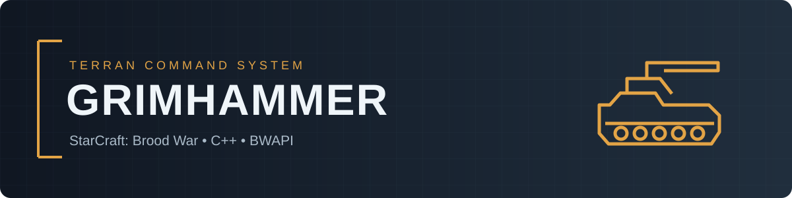

<p align="center"></p>

<p align="center">


</p>

# GrimHammer

GrimHammer is a **Terran AI bot for StarCraft: Brood War**, written in C++ using [BWAPI](https://bwapi.github.io/). It is based on [Steamhammer](https://satirist.org/ai/starcraft/steamhammer/), which is descended from [UAlbertaBot](https://github.com/davechurchill/ualbertabot).

The project focuses on Terran play, with custom strategies and adjustments to army control and production.

## Getting started

You need StarCraft: Brood War 1.16.1, a compatible BWAPI installation, and Visual Studio with C++ tools to build the bot.

```powershell
.\scripts\build.ps1 -BwapiDir "C:\BWAPI"
```

See the [build guide](docs/BUILD.md) and [setup guide](docs/RUNNING.md) for instructions. Strategies and settings are configured in [GrimHammer.json](config/GrimHammer.json).

## Project structure

| Directory | Contents |
| --- | --- |
| [`Steamhammer/Source/`](Steamhammer/Source/README.md) | Bot source code and subsystem guide |
| [`Steamhammer/VisualStudio/`](Steamhammer/VisualStudio/) | Visual Studio solution and project |
| [`config/`](config/) | Bot configuration and build orders |
| [`BOSS/`](BOSS/) and [`BWAPILIB/`](BWAPILIB/) | Supporting libraries |
| [`docs/`](docs/) and [`scripts/`](scripts/) | Documentation and build script |

## StarCraft AI resources

- [BASIL Ladder](https://www.basil-ladder.net/) — bot matches, rankings, and replays.
- [SSCAIT](https://sscaitournament.com/) — the Student StarCraft AI Tournament and ladder.
- [BWAPI](https://bwapi.github.io/) — the Brood War API and documentation.
- [Steamhammer](https://satirist.org/ai/starcraft/steamhammer/) — the original project, downloads, and documentation.
- [UAlbertaBot](https://github.com/davechurchill/ualbertabot) — the underlying starter bot.

## Credits and licenses

GrimHammer is developed by **Nazar Biriukov**. Thanks to **Jay J. P. Scott** for Steamhammer and **David Churchill** for UAlbertaBot and BOSS.

See [LICENSE](LICENSE), [third-party notices](THIRD_PARTY_NOTICES.md), and [contributing guidelines](CONTRIBUTING.md).
